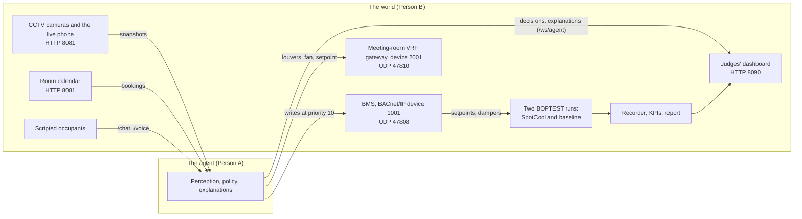

# Draft: the root README's world section

**Status: superseded on Nov 4 by the root [`README.md`](../../README.md) (AG6),** which carries this section's content with the agent's result. Kept as the first draft. Like the README, it leaves out the old single-AC headline, which no run of ours supports (`docs/release/numbers.md`).

---

## How SpotCool is built: the agent and the world

SpotCool is a supervisory agent for an office building's existing CCTV and building management system (BMS). It counts the people in each zone from the cameras, and it tells the BMS which zones are empty, so their cooling eases off and their airflow shuts off while people elsewhere stay comfortable. It also aims the meeting room's air-conditioner louvers at the people in it.

The repo has two halves, joined only by the contracts in [`packages/contracts`](packages/contracts):

- **The agent (Person A)** perceives, decides and explains: camera snapshots and room bookings in, BACnet writes and plain-language explanations out. Its interfaces are in [Person A's integration handoff](docs/integration/PERSON_A_HANDOFF.md).
- **The world (Person B, [`packages/world`](packages/world))** stands in for a real building. It runs a physics-grade five-zone office ([BOPTEST](https://github.com/ibpsa/project1-boptest)) twice, once under SpotCool and once as the baseline. It serves the interfaces a real building has: a BACnet/IP BMS, the meeting room's VRF gateway, CCTV cameras, a room calendar and scripted occupants who complain. It also records every run and scores it, and feeds the judges' dashboard ([`apps/dashboard`](apps/dashboard)). Swap the world for real hardware and the agent's code does not change.



Both runs see the same weather, the same building and the same BMS; only the SpotCool run gets the agent's writes. An operator at BACnet priority 8 always beats the agent at 10.

### Run the world

Python 3.11 and [uv](https://docs.astral.sh/uv/); on Windows, keep the virtualenv outside OneDrive.

```bash
uv sync --all-packages --all-extras
uv run spotcool-world run --plant rc --speed 300 --stub-agent    # the demo day on the fast RC model
uv run spotcool-world report <run_id>                            # the run's KPIs, verdict and charts
cd apps/dashboard && npm ci && npm run build                     # the dashboard, served on port 8090
```

- `--plant boptest-local` runs the real building model, which needs a BOPTEST service. We run ours in a GitHub Codespace: [`docs/runbooks/boptest-codespace.md`](docs/runbooks/boptest-codespace.md).
- `--stub-agent` stands in for the agent with perfect perception, from the scenario's script. Its results are labelled as an upper bound, never as SpotCool's.
- Checks: `uv run pytest`, and the golden evals with `uv run pytest -m eval`.
- Everything else: the engineering guide [`packages/world/AGENTS.md`](packages/world/AGENTS.md), the operator runbooks in [`docs/runbooks/`](docs/runbooks/), and the numbers the video may quote in [`docs/release/numbers.md`](docs/release/numbers.md).

### Honesty

- **Comfort is scored only where the scenario has people.**
- **BOPTEST's occupant heat follows its fixed schedule**, so savings in zones the cameras show empty may be overstated by up to the occupants' heat. The RC model, whose occupant heat follows the scenario, and the everyone-in `all_hands_day` scenario bracket this.
- **BOPTEST's own discomfort KPIs** count every zone as occupied all day.
- Licences: [`CREDITS.md`](CREDITS.md).
