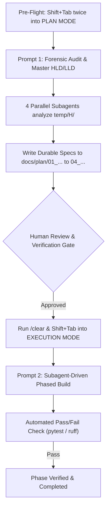

# SpotCool AI — Master Claude Code Workflow Guide
### Grounded in Official Anthropic Best Practices & Research

> **Target Tool:** Claude Code CLI (Anthropic)  
> **Official Sources:**  
> • [Claude Code Best Practices (Anthropic Research, Apr 2025)](https://www.anthropic.com/research/claude-code-best-practices)  
> • [Best Practices for Claude Code (Official Docs)](https://code.claude.com/docs/en/best-practices)  
> **Hackathon:** Meta Global AI Developer Hackathon (Oct 26 – Nov 4, 2026)

---

## 1. Official Anthropic Best Practices: How They Apply to SpotCool AI

Anthropic's engineering team and documentation outline six core principles for agentic coding. Here is how our workspace is configured to enforce them:

| Anthropic Principle | What the Official Docs Say | How SpotCool AI Implements It |
| :--- | :--- | :--- |
| **1. Deterministic vs. Non-Deterministic Instructions** | Non-deterministic instructions (prompts, `CLAUDE.md`) guide the model, but lack guarantees. Deterministic instructions (tests, compilers, Stop hooks, permission rules) enforce hard invariants. | We don't ask Claude to "try to remember louver limits." We enforce hard Pydantic bounds ($-45^\circ$ to $+45^\circ$) and automated pytest suites that return exit code 0 or 1. |
| **2. Tell Claude What It Can't See** | Claude automatically inspects code, directory structure, and tests. Only document what it *cannot* find in code: team decisions, gotchas, hidden pitfalls, and why things exist. | `CLAUDE.md` documents only non-obvious gotchas: SAM 3 mask-only median depth filtering, 15°/sec stepper slewing, and the "AC Clone" appliance-only twin model. |
| **3. Keep CLAUDE.md Short & Scope Rules** | `CLAUDE.md` is loaded into *every* turn, consuming attention and tokens. Keep it short (~50–100 lines) and move component-specific rules to `.claude/rules/` with `paths:` filters. | Root `CLAUDE.md` is strictly ~60 lines. We created path-scoped rules in `.claude/rules/`: `perception.md` for CV, `digital_twin.md` for UI/actuators, and `backend.md` for FastAPI. |
| **4. Brainstorm with Claude First (The Interview Pattern)** | When requirements are complex, don't dump everything into code. Instruct Claude to interview you until a specification can be written to disk. | Use **Prompt 0** below: *"Interview me about the AC Digital Twin state contracts until you can write `SPEC.md`."* |
| **5. Give Claude a Pass/Fail Check to Close the Loop** | If Claude has nothing to run that returns pass/fail, you become the test suite. If given a command it can run, Claude tests, reads stderr, and self-corrects autonomously. | Every execution prompt includes an explicit verification command (`pytest tests/`, `ruff check src/`). Claude runs it, fixes errors, and iterates without human hand-holding. |
| **6. Review Against Spec with Subagents (Skip Style)** | Use subagents to review changes strictly against the specification (`SPEC.md` or `docs/plan/`), checking requirement coverage and edge cases while skipping subjective style debates. | Prompt 1 and 2 utilize parallel subagent tracks to audit R&D and verify pull requests against our hackathon rubric. |

---

## 2. Directory & Rule Structure

```
SpotCool-AI/
├── CLAUDE.md                       # Lean root guide: commands, gotchas, high-level architecture
├── .claude/
│   └── rules/                      # Path-scoped rules (Anthropic best practice)
│       ├── perception.md           # Scoped to src/perception/** (SAM 3, Depth, back-projection)
│       ├── digital_twin.md         # Scoped to src/digital_twin/** (15°/sec slew, Web Audio piezo, wattage)
│       └── backend.md              # Scoped to src/backend/** (Pydantic schemas, WebSockets, PMV)
├── docs/
│   ├── workflow/
│   │   └── CLAUDE_WORKFLOW_GUIDE.md# This comprehensive master guide
│   └── plan/                       # Durable architecture state generated by Prompt 1
└── temp/H/                         # [Git-ignored] R&D, whiteboards, rubrics & transcripts
    ├── INDEX.md                    # Catalog of all hackathon research
    ├── whiteboard_and_rubric_analysis.md # Detailed report on whiteboards and judging criteria
    ├── gemini_task.md              # Empirical commercial HVAC electricity research
    └── conversation_1/2/3.md       # Pre-hackathon brainstorming & architecture chats
```

---

## 3. Step-by-Step Claude Code Execution Workflow



---

## Prompt 0: The "Brainstorm / Interview Me" Pattern (Optional Pre-Planning)

If you want Claude Code to refine a specific feature (like multi-occupant time-multiplexed sweeping or open-door energy leak thresholds) before writing the full plan:

```markdown
I want to lock in the exact control logic for [Multi-Occupant Airflow Sweeping / Open Door Eco Mode].
Act as a Principal HVAC Systems Engineer. Interview me with focused multiple-choice questions until we have pinned down all edge cases, sensor bounds, and fallback behaviors.
Once you have enough detail, write the specification to `docs/plan/SPEC_[FEATURE].md`.
```

---

## Prompt 1: Forensic Review, R&D & Master Architecture (Copy-Paste into Plan Mode)

Press **`Shift+Tab`** twice to enter **`PLAN MODE`**, then paste:

```markdown
<role>
You are the Principal AI Systems Architect and Climate Tech Engineering Lead for SpotCool AI.
Operate strictly from first-principles engineering: question every assumption, replace hand-waving heuristics with verifiable thermodynamics (ASHRAE Standard 55, Fanger PMV), enforce strict separation of concerns across our multi-agent pipeline, and design for zero-latency execution.
</role>

<objective>
We are competing in the Meta Global AI Developer Hackathon. Our mission is to eliminate up to 60% of commercial and residential HVAC energy waste by replacing passive uniform cooling with real-time, human-centric 3D "spot cooling."

We have amassed comprehensive research, whiteboard control-engineering models, hackathon rubrics, and three prior architectural ideation sessions in `temp/H/`. 

Your goal in this session is strictly **Deep Review, R&D Synthesis, and End-to-End System Design (HLD + LLD)**. Do NOT write production code yet. You must thoroughly audit our existing knowledge base, reconcile our mathematical models, and write a production-grade system specification and phased implementation roadmap to `docs/plan/`.
</objective>

<parallel_subagent_tasks>
To preserve context window hygiene and avoid compaction, spawn parallel subagents to investigate the following four tracks independently and return structured forensic findings:

1. **Subagent 1 — Empirical Research & Macro Climate Impact:**
   - Audit `@temp/H/gemini_task.md` and `@temp/H/project_details.md`.
   - Synthesize our empirical citations (U.S. EIA CBECS Tables E5/E6, IEA Future of Cooling, MoSPI/BEE 2026 stats, Loughborough Univ./ERSS 2022 hybrid office waste benchmarks).
   - Formulate the exact mathematical and economic justification for our "Power N households for N days" and "up to 60% energy savings" pitch metrics.

2. **Subagent 2 — Control Engineering, Process Variables & Digital Twin Model:**
   - Audit `@temp/H/whiteboard_and_rubric_analysis.md` and the visual whiteboard assets (`@temp/H/assets/whiteboard_system_concept_and_climate_impact.jpeg` and `@temp/H/assets/whiteboard_control_engineering_and_digital_twin.jpeg`).
   - Formalize our 4 process control variable classes:
     - Set variables: Target temperature, humidity, CO2 limits.
     - Manipulated variables: Fan speed/RPM, horizontal pan angle, vertical tilt angle, valve opening.
     - Disturbance variables: Ambient outdoor temp, occupancy count/movement, solar heat gain, clothing insulation (Clo), door/window leaks.
     - Controlled variables: Local zone temperature, relative humidity, occupant PMV index.
   - Refine the mathematical specification for the **"AC Clone" Digital Twin**: 20 Hz tick loop, 15°/sec stepper motor slew, blower RPM velocity curves, and real-time compressor wattage modeling.

3. **Subagent 3 — Meta AI Perception Stack & Sponsor Cloud Alignment:**
   - Audit `@temp/H/conversation_3.md`, `@temp/H/conversation_2.md`, and `@temp/H/conversation_1.md`.
   - Specify the exact implementation architecture for our perception agents:
     - Visual & Spatial Agent: Meta SAM 3 (zero-shot segmentation) + Depth Anything V2 (monocular depth) + Pinhole Camera Back-Projection to (X,Y,Z) meters + Louver angle geometry (arctan2).
     - Semantic Visual Agent: Meta Llama Vision for clothing insulation classification (Clo) and energy leak detection.
     - Acoustic Agent: Silero VAD + Whisper / fast intent classification for implicit thermal feedback ("It's freezing", "Turn it up").
     - Thermodynamic Policy Orchestrator: Meta Llama (Reasoning) with structured JSON function-calling.
   - Align the architecture with our sponsor compute platforms (Baseten Truss serving, Fireworks AI low-latency endpoints, Modal serverless GPU containers).

4. **Subagent 4 — Hackathon Rubric Alignment & Demo Choreography:**
   - Audit `@temp/H/hackathon_details.md` and `@temp/H/assets/meta_hackathon_judging_rubric.jpeg`.
   - Map our architecture against the 4 weighted judging pillars: Impact (30%), Meta AI Tooling (25%), Demo (25%), Technical Depth (20%).
   - Design a foolproof 90-second live demo choreography and video walkthrough that proves closed-loop control to Stage Three final judges.
</parallel_subagent_tasks>

<architectural_invariants>
When writing the system design, enforce these non-negotiable engineering invariants:
1. **Canonical JSON State Bus:** Agents never talk via unstructured text. All perception nodes push to a unified in-memory state aggregator (FastAPI + WebSockets) at native frame rates (Fast 10 Hz kinematic loop vs. Slow 0.2 Hz semantic loop).
2. **Appliance-Only Digital Twin:** We are NOT modeling the entire room in 3D. We model the **AC unit itself** ("AC Clone"). The AI Orchestrator acts as the human hand pressing the remote; the AC Digital Twin acts as the wall-mounted appliance receiving those commands and actuating internal louvers and fans.
3. **Deterministic Actuation Slew:** Never allow instantaneous state jumps. Louvers must physically slew at realistic stepper speeds (15°/sec); fan RPM must accelerate gradually; wattage must respond dynamically.
4. **Thermodynamic Grounding:** Replace "LLM vibes" with Fanger's Predicted Mean Vote (PMV) equation calculated deterministically in Python using air velocity, occupant distance, Clo value, and ambient temperature.
</architectural_invariants>

<deliverables>
Synthesize the subagent reports and write the following four structured documents to `docs/plan/`:

1. `01_RESEARCH_AND_IMPACT_SYNTHESIS.md`:
   - Full synthesis of commercial building energy data, baseline comparisons, and verifiable energy savings calculations.
2. `02_SYSTEM_ARCHITECTURE_HLD_LLD.md`:
   - High-Level Architecture (Mermaid topology diagram), component interfaces, and Low-Level Design (Pydantic schemas for the 4 process variable classes and API endpoints).
3. `03_AC_DIGITAL_TWIN_AND_PERCEPTION_SPEC.md`:
   - Detailed specification for SAM 3 + Depth back-projection math, Llama Vision prompts, Silero VAD loop, and the interactive AC Clone Digital Twin (SVG/Canvas animation, Web Audio piezo beeps, IR hex generator).
4. `04_HACKATHON_EXECUTION_ROADMAP.md`:
   - Sequenced, dependency-ordered 24-hour build plan broken into 5 concrete phases with strict testable verification criteria for each phase.
</deliverables>

<verification_gate>
STOP immediately after generating the four documents in `docs/plan/`.
Present an executive summary in chat highlighting key architectural decisions and technical trade-offs. Wait for my review and explicit approval before switching out of Plan Mode or writing application code.
</verification_gate>
```

---

## Step 1.5: Context Window Reset (Run After Plan Approval)

Once Claude Code finishes Prompt 1 and you review/approve `docs/plan/`:

1. **Clear the context window:**
   ```bash
   /clear
   ```
2. **Switch out of Plan Mode:**
   * Press **`Shift+Tab`** twice to return to **`EDIT / EXECUTION MODE`**.

---

## Prompt 2: Subagent-Driven Phased Execution (Copy-Paste into Normal Mode)

```markdown
<role>
You are the Lead Systems & Full-Stack AI Engineer for SpotCool AI, executing the approved engineering specifications defined in `@docs/plan/`.
</role>

<execution_rules>
1. **Source of Truth:** Ground all work in:
   - `@docs/plan/02_SYSTEM_ARCHITECTURE_HLD_LLD.md`
   - `@docs/plan/03_AC_DIGITAL_TWIN_AND_PERCEPTION_SPEC.md`
   - `@docs/plan/04_HACKATHON_EXECUTION_ROADMAP.md`
2. **Strict Phase-by-Phase Execution:**
   - Execute **only ONE phase** from `04_HACKATHON_EXECUTION_ROADMAP.md` per turn.
   - Do not jump ahead to frontend graphics before backend state contracts are verified.
3. **Execution Order:**
   - **Phase 1: Canonical State Bus & Backend Foundation** (FastAPI, WebSockets, Pydantic schemas for the 4 process variable classes, in-memory state store).
   - **Phase 2: Vision & Spatial Pipeline** (OpenCV video loop, SAM 3 mask extraction, monocular depth back-projection, louver pan/tilt angle calculation).
   - **Phase 3: Interactive AC Clone Digital Twin** (20 Hz stepper motor slew simulation, fan RPM velocity curves, SVG/React chassis, animated particle streamlines, Web Audio 2400 Hz remote beep).
   - **Phase 4: Thermodynamic Policy Orchestrator & Acoustic Agent** (Meta Llama API structured JSON tool-calling, Fanger PMV calculation, Silero VAD audio loop, in-context comfort memory).
   - **Phase 5: Live Judge Telemetry Dashboard & Demo Integration** (Real-to-sim webcam overlay, dual wattage comparison meter, simulated IR hex stream, 90-second demo script).
4. **Autonomous Pass/Fail Loop:**
   - After implementing each module, run the verification command (e.g. `pytest tests/`, `ruff check src/`).
   - If tests fail, inspect stderr, fix the code, and rerun until all tests pass.
   - Output the passing terminal logs and update the checkboxes in `@docs/plan/04_HACKATHON_EXECUTION_ROADMAP.md`.
</execution_rules>

Begin now with **Phase 1** of `@docs/plan/04_HACKATHON_EXECUTION_ROADMAP.md`. 
Create the project environment, define the state schemas, and start the FastAPI WebSocket service. Stop and show me the test verification output before proceeding to Phase 2.
```

---

## Prompt 3: Spec-Grounded Review (Anthropic Best Practice)

When reviewing any newly implemented phase or git diff:

```markdown
Use a subagent to review the git diff against `@docs/plan/02_SYSTEM_ARCHITECTURE_HLD_LLD.md` and `@docs/plan/03_AC_DIGITAL_TWIN_AND_PERCEPTION_SPEC.md`.
Check that every required invariant is implemented and that all edge cases have unit tests.
Report any correctness bugs or missing constraints, and skip cosmetic style comments.
```

---

## 4. Claude Code Cheat Sheet for SpotCool AI

| Action | Command / Shortcut | Anthropic Rationale |
| :--- | :--- | :--- |
| **Enter Plan Mode** | `Shift+Tab` (twice) | Prevents Claude from writing premature, broken code while investigating. |
| **Exit Plan Mode** | `Shift+Tab` (twice) | Re-enables code editing once the plan is locked in. |
| **Reset Context** | `/clear` | Prevents context window blowout (>50%); frees tokens for code generation. |
| **Compact Memory** | `/compact` | Compresses long conversational memory while maintaining key working state. |
| **Check Tool Connections**| `/mcp` | Verifies active MCP servers and tools before running workflows. |
| **Review Diffs** | `/review` | Analyzes uncommitted git diffs against the base branch. |
